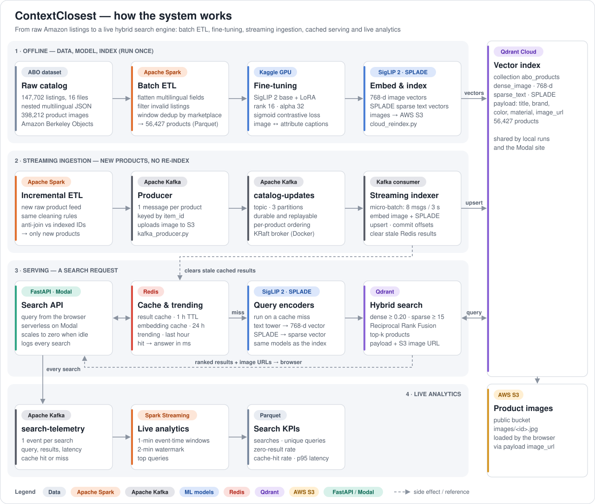

# ContextClosest — Hybrid Multimodal Product Search

ContextClosest searches a catalog of **56,427 Amazon products** in plain language
("sunglasses for men", "white sneakers for girls"). It combines a fine-tuned
**SigLIP 2** vision-language model, which matches your words to product *images*,
with **SPLADE** keyword vectors for exact terms, fused with **Reciprocal Rank
Fusion** in **Qdrant**.

Around the search engine sits a big data pipeline: **Apache Spark** cleans the raw
catalog, **Apache Kafka** streams new products into the live index without a
rebuild, **Spark Structured Streaming** turns search traffic into live metrics,
and **Redis** caches results and tracks trending searches. The public site runs
serverless on **Modal**.

---

## Contents

1. [Features](#features)
2. [How it works](#how-it-works)
3. [Results](#results)
4. [Repository structure](#repository-structure)
5. [Setup](#setup)
6. [Building the catalog and index from scratch](#building-the-catalog-and-index-from-scratch)
7. [Running locally](#running-locally)
8. [Adding new products (Spark → Kafka)](#adding-new-products-spark--kafka)
9. [Live search analytics](#live-search-analytics)
10. [Deploying on Modal](#deploying-on-modal)
11. [Configuration](#configuration)
12. [API](#api)
13. [Troubleshooting](#troubleshooting)
14. [Tech stack](#tech-stack)

---

## Features

- **Semantic + keyword search** — dense SigLIP 2 (+ LoRA) image vectors and sparse SPLADE text vectors, merged with RRF; score thresholds drop irrelevant matches.
- **Fine-tuned on the catalog** — LoRA (rank 16) contrastive training on product image–caption pairs.
- **Spark ETL** — 147,702 nested, multilingual raw listings → 56,427 clean products, with a per-stage funnel report.
- **Streaming ingestion** — new products flow Spark → Kafka → indexer → Qdrant and are searchable within seconds, with no re-index or restart.
- **Redis serving layer** — result and query-embedding caches (invalidated automatically when products are added) and a "trending searches" bar over the last hour.
- **Live analytics** — search volume, zero-result rate, cache-hit rate and p95 latency per minute, from Kafka telemetry.
- **Serverless deployment** — Modal scales to zero when idle; images load from a public S3 bucket.
- Every big data component is optional: without Redis or Kafka the search engine still runs.

---

## How it works



**A search request:** the query is embedded twice — SigLIP 2 text tower (768-d
dense) and SPLADE (sparse). Qdrant runs both searches, keeps candidates above a
score threshold (dense ≥ 0.20, sparse ≥ 15.0) and fuses them with RRF. Redis
answers repeated queries from memory before any of that runs.

**A new product:** Spark cleans the raw listing and skips anything already
indexed; the producer publishes it to Kafka (uploading its image to S3 first);
the consumer embeds the product image with the same fine-tuned model as the
offline index, upserts it into Qdrant, and clears cached results so searches see
it immediately. Because Modal and your local machine share the same Qdrant Cloud
index, products you stream in locally appear on the public site too.

More detail: [`docs/BIGDATA_INTEGRATION.md`](docs/BIGDATA_INTEGRATION.md).

---

## Results

Measured on a laptop (Intel i5-1335U, CPU only):

| Measurement | Result |
|---|---|
| Spark ETL, full catalog | 147,702 → 56,427 products in 30.9 s; identical product set to the Pandas cleaner |
| Streamed vs batch-indexed products | 30 of 30 products ranked identically (top-1 0.80, top-10 0.967, MRR@10 0.853) |
| Redis cache | median server time 2.94 s on a miss vs 79 ms on a hit (about 37×) |
| Publish → searchable | 16.7 s median for a batch of 30 (dominated by CPU image embedding) |

---

## Repository structure

```
├── app.py                        # FastAPI app: search API, web UI, Kafka telemetry
├── config.py                     # Paths and constants
├── modal_app.py                  # Modal deployment (serverless web endpoint)
├── docker-compose-bigdata.yml    # Kafka (KRaft) + Redis for local runs
├── requirements.txt              # Core: data prep, models, API
├── requirements-bigdata.txt      # Spark, Kafka, Redis clients
├── requirements-modal.txt        # Modal image
├── .env.example                  # Every setting the code reads
│
├── data_pipeline/
│   ├── download.py               # Checks the raw ABO files are in place
│   ├── loader.py                 # Streaming gzip JSON reader (Pandas path)
│   ├── schema.py                 # Product dataclass + caption builder
│   ├── clean.py                  # Single-process Pandas cleaner (reference)
│   ├── spark_clean.py            # Spark ETL: full catalog or incremental feed
│   ├── package_for_kaggle.py     # Zips catalog + images for GPU training on Kaggle
│   ├── kafka_producer.py         # Publishes new products (optional S3 image upload)
│   ├── kafka_consumer.py         # Streaming indexer: Kafka → Qdrant + cache refresh
│   └── spark_telemetry_stream.py # Spark Structured Streaming search analytics
│
├── training/
│   ├── lora_config.py            # LoRA hyperparameters
│   └── train.py                  # SigLIP 2 contrastive fine-tuning
│
├── indexing/
│   ├── inference.py              # InferenceEngine: SigLIP 2 + LoRA, SPLADE
│   └── build_index.py            # Builds a local Qdrant collection
│
├── search/
│   ├── engine.py                 # HybridSearchEngine: embed → Qdrant RRF → results
│   └── cache.py                  # Redis caches + sliding-window trending
│
├── scripts/
│   ├── upload_to_s3.py           # Uploads catalog images to the public S3 bucket
│   ├── cloud_reindex.py          # Uploads all vectors + payloads to Qdrant Cloud
│   └── fix_image_urls.py         # One-off repair of image_url payloads
│
├── deploy/lora_adapter/          # Fine-tuned LoRA adapter (4.6 MB, used by Modal)
├── conf/log4j2.properties        # Quiet Spark logging (unless --verbose)
├── static/                       # Web UI: index.html, styles.css, app.js
└── docs/
    ├── BIGDATA_INTEGRATION.md    # Pipeline design and operations
    └── DEPLOY_MODAL.md           # Modal deployment guide
```

`Raw_Data/` and `Processed_Data/` hold the dataset, embeddings and model outputs;
they are git-ignored.

---

## Setup

**Prerequisites**

- Python 3.11 (e.g. `conda create -n ai_env python=3.11`)
- For the big data pipeline: **Java 17** (Spark) and **Docker Desktop** (Kafka + Redis)
- A **Qdrant Cloud** cluster, and an **S3 bucket** with public read for product images

**Install**

```bash
conda activate ai_env
pip install -r requirements.txt
pip install -r requirements-bigdata.txt      # Spark, Kafka, Redis
cp .env.example .env                          # then fill in Qdrant + AWS values
```

**Dataset** — download the [Amazon Berkeley Objects](https://amazon-berkeley-objects.s3.amazonaws.com/index.html)
listings and small images and unpack them so that these paths exist:

```
Raw_Data/abo-listings/listings/metadata/*.json.gz
Raw_Data/abo-images-small/images/metadata/images.csv.gz
Raw_Data/abo-images-small/images/small/...
```

Check with `python data_pipeline/download.py`.

---

## Building the catalog and index from scratch

Skip this section if your Qdrant Cloud collection `abo_products` is already populated.

**1. Clean the raw catalog**

```bash
python data_pipeline/clean.py            # writes Processed_Data/products.parquet + images
python data_pipeline/spark_clean.py      # same cleaning in Spark → Processed_Data/spark_products.parquet
```

Both produce the same 56,427 products. The row order of `products.parquet` is
what the offline embeddings and the Qdrant point IDs follow, so keep using one
catalog file for steps 2–4.

**2. Fine-tune SigLIP 2 (GPU)** — package the catalog for Kaggle and train there:

```bash
python data_pipeline/package_for_kaggle.py   # → kaggle_dataset.zip
python training/train.py                      # on a Kaggle GPU
```

Copy the resulting adapter to `Processed_Data/models/lora_adapter/` (and to
`deploy/lora_adapter/` for Modal).

**3. Compute embeddings** — dense image vectors (`Processed_Data/image_embeddings.npy`)
and SPLADE vectors (`Processed_Data/sparse_text_embeddings.json`), on Kaggle or
locally; `indexing/build_index.py` computes any that are missing (slow on CPU).

**4. Publish images and vectors**

```bash
python scripts/upload_to_s3.py       # product images → s3://<bucket>/images/
python scripts/cloud_reindex.py      # vectors + payloads → Qdrant Cloud
```

`python indexing/build_index.py` builds a local, on-disk Qdrant collection
instead (single process only; the streaming pipeline needs Qdrant Cloud or a
Qdrant server).

---

## Running locally

```bash
docker compose -f docker-compose-bigdata.yml up -d    # Kafka + Redis (optional)
python app.py                                         # http://localhost:8000
```

`curl http://localhost:8000/api/health` shows whether Redis and Kafka are
connected. Without Docker running, search still works, just without caching,
trending or telemetry.

---

## Adding new products (Spark → Kafka)

New products arrive as a raw feed in the ABO listing format (JSON lines,
optionally `.gz`). Each product's `main_image_id` must be listed in the image
metadata, with the image file under `Raw_Data/abo-images-small/images/small/`.

**Terminal 1 — start the streaming indexer** (keep it running):

```bash
python data_pipeline/kafka_consumer.py
```
```
✓ AI models loaded
✓ Connected to Qdrant vector database — 56,427 products indexed
✓ Connected to Redis cache
✓ Kafka consumer listening on topic 'catalog-updates' — waiting for new products...
```

**Terminal 2 — clean the feed and publish the new products:**

```bash
python data_pipeline/spark_clean.py --input path/to/feed_dir --against-index --output Processed_Data/new_products.parquet
python data_pipeline/kafka_producer.py --parquet Processed_Data/new_products.parquet --upload-images
```

- `--against-index` reads the item IDs already in Qdrant, and Spark's anti-join
  keeps only products that are not indexed yet. The funnel table shows what each
  cleaning stage removed.
- `--upload-images` uploads each new image to the S3 bucket (skipping ones
  already there) so the deployed site can show it. Add `--dry-run` to check
  everything without publishing.

Terminal 1 then shows `Indexing new products: 30/30` and
`✓ 30 new products are now searchable`. New products carry a **NEW** badge in the
UI for 7 days.

Delivery is at-least-once: offsets are committed only after the Qdrant upsert,
and point IDs are derived from `item_id`, so re-sending a product overwrites it
instead of duplicating it. Add `--verbose` to any of these commands for full logs.

---

## Live search analytics

```bash
python data_pipeline/spark_telemetry_stream.py --window "1 minute"
```

Reads the `search-telemetry` topic that `app.py` writes on every search and
prints, per window: searches, unique queries, zero-result rate, cache-hit rate,
average and p95 latency, plus the top queries. Windows are appended to
`Processed_Data/telemetry/window_metrics/` (Parquet). The first run downloads
the Spark–Kafka connector from Maven.

---

## Deploying on Modal

The public site is the same FastAPI app running serverless on
[Modal](https://modal.com), reading the same Qdrant Cloud index.

```bash
pip install modal
modal token new                                                     # one time
modal secret create qdrant QDRANT_URL="https://..." QDRANT_API_KEY="..."
modal deploy modal_app.py
```

It prints `https://<username>--contextclosest-search-web.modal.run`.

- **New products** streamed in with the Kafka pipeline (from your machine) show up
  on the Modal site as soon as the consumer indexes them; images come from S3.
- **Redis (optional)**: create a free hosted Redis (e.g. Upstash), run
  `modal secret create redis REDIS_URL="rediss://default:<password>@<host>:6379"`,
  set `ENABLE_REDIS = True` in `modal_app.py` and redeploy. Put the same
  `REDIS_URL` in your local `.env` so the consumer clears the Modal app's cache
  when it adds products.
- **Kafka telemetry** is off on Modal, since the broker runs locally.

Full guide: [`docs/DEPLOY_MODAL.md`](docs/DEPLOY_MODAL.md).

---

## Configuration

All settings come from environment variables (`.env` locally, Modal secrets in
the cloud):

| Variable | Used by | Default |
|---|---|---|
| `QDRANT_URL`, `QDRANT_API_KEY` | API, consumer, Spark `--against-index`, scripts | local on-disk Qdrant if unset |
| `AWS_ACCESS_KEY_ID`, `AWS_SECRET_ACCESS_KEY`, `AWS_BUCKET_NAME`, `AWS_REGION` | image upload, Spark `image_url` | — |
| `REDIS_URL` or `REDIS_HOST`, `REDIS_PORT`, `REDIS_PASSWORD` | API, consumer | `127.0.0.1:6379` |
| `KAFKA_BOOTSTRAP` | API telemetry, producer, consumer, analytics | `localhost:9092`; empty turns API telemetry off |
| `TORCH_NUM_THREADS` | model inference | `min(4, available CPUs)` |
| `LORA_ADAPTER_DIR` | model loading | `Processed_Data/models/lora_adapter`, else `deploy/lora_adapter` |

---

## API

| Endpoint | Description |
|---|---|
| `GET /` | Web UI |
| `GET /api/search?q=<text>&top_k=12` | Hybrid search. `top_k` 1–50. Returns `results`, `count`, `elapsed_ms`, `cache_hit`, `no_results`; each result has `title`, `brand`, `color`, `material`, `category`, `image_url`, `score`, `is_new` |
| `GET /api/trending?n=5` | Most searched queries in the last hour (only searches that returned products) |
| `GET /api/health` | Status, plus `redis_available` and `kafka_producer` |

---

## Troubleshooting

| Problem | Fix |
|---|---|
| Spark fails with `'JavaPackage' object is not callable` | A system-wide `SPARK_HOME` points to another Spark version. The scripts override it with the pip-installed PySpark; make sure you run them with the same Python that has `pyspark`. |
| Spark on Windows cannot write files | Set `HADOOP_HOME` to a folder containing `bin/winutils.exe` and `hadoop.dll`. |
| Telemetry job: `download failed: ...jsr305.jar` | A local Maven cache (`~/.m2`) has a POM without its JAR. Delete that folder under `~/.m2/repository` (or add the JAR) and rerun. |
| Consumer prints `NotCoordinatorError` warnings once | Kafka is creating its internal offsets topic on first use; they stop within seconds. |
| Searches take several seconds | Check `TORCH_NUM_THREADS` (too many threads slows hybrid laptop CPUs) and that the laptop is not in battery-saver mode. |
| `/api/health` shows `"kafka_producer": false` | Kafka was not running when `app.py` started: `docker compose -f docker-compose-bigdata.yml up -d`, then restart the app. |
| A product added through Kafka does not appear | Check the consumer printed `✓ ... now searchable`, and that the API and the consumer use the same `QDRANT_URL`. |

---

## Tech stack

| Layer | Technology |
|---|---|
| Dense embeddings | `google/siglip2-base-patch16-224` + LoRA (PEFT) |
| Sparse embeddings | `prithivida/Splade_PP_en_v1` (FastEmbed) |
| Vector database | Qdrant Cloud (RRF fusion) |
| Batch ETL | Apache Spark 4 (PySpark) |
| Streaming | Apache Kafka (KRaft), kafka-python |
| Streaming analytics | Spark Structured Streaming |
| Cache and trending | Redis 7 |
| API | FastAPI + Uvicorn |
| Deployment | Modal (serverless), AWS S3 (images), Docker Compose (local Kafka + Redis) |
| Dataset | [Amazon Berkeley Objects](https://amazon-berkeley-objects.s3.amazonaws.com/index.html) |
