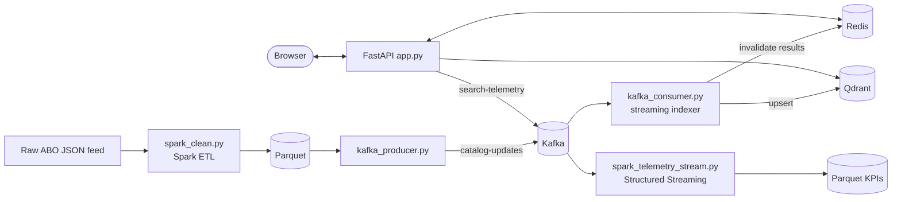

# Big Data Pipeline

ContextClosest keeps its search index fresh and fast with three tools:
**Apache Spark** for batch cleaning, **Apache Kafka** for streaming new products
into the live index (plus search telemetry into **Spark Structured Streaming**),
and **Redis** as the serving layer. Each stage's output is the next stage's input.



## Apache Spark — `data_pipeline/spark_clean.py`

Cleans raw Amazon Berkeley Objects listings into searchable products, using
native Spark SQL functions (no Python UDFs in the default path):

1. Flatten the multilingual `{language_tag, value}` arrays, preferring
   en_US → en_CA → en_GB → en_AU → en_IN, then any `en_*`.
2. Drop swatches, phone cases (`cellular_phone_case`) and listings without an English title.
3. Join with `images.csv.gz` to resolve each product's image; listings without one drop out.
4. Deduplicate cross-marketplace copies: `row_number()` over `item_id`, ordered US > CA > GB > AU > IN.
5. Optional anti-join against the item IDs already indexed, so only new products continue:
   `--against-index` reads them from Qdrant, `--existing` from a Parquet file.
6. Write Snappy Parquet plus a `*_funnel.json` report with the record count after each stage.

```bash
python data_pipeline/spark_clean.py                       # full catalog: 147,702 → 56,427
python data_pipeline/spark_clean.py --input <feed_dir> --against-index \
    --output Processed_Data/new_products.parquet
```

Measured on the full catalog (laptop, local mode): native Spark 30.9 s, the
same logic as Python UDFs 145.8 s, the single-process Pandas cleaner 14.5 s.
All three produce the same 56,427 products. At this size the data fits in one
process, so Pandas is faster; the Spark job runs unchanged on a cluster.

Requires Java 17. The script points `SPARK_HOME` at the pip-installed PySpark,
so a different system-wide Spark install does not interfere.

## Apache Kafka — `kafka_producer.py`, `kafka_consumer.py`

| Topic | Producer | Consumer | Message |
|---|---|---|---|
| `catalog-updates` (3 partitions) | `kafka_producer.py --parquet … [--upload-images]` | `kafka_consumer.py` | one product, keyed by `item_id` |
| `search-telemetry` (3 partitions) | `app.py`, on every search | `spark_telemetry_stream.py` | `{query, count, elapsed_ms, cache_hit, ts}` |

With `--upload-images` the producer first uploads each product's image to the
public S3 bucket (`images/<file name>`, skipped if already there) and sets
`image_url`, so the deployed site can show it. `--dry-run` prepares everything
without publishing.

The streaming indexer:

- polls in micro-batches of 8 messages or 3 seconds, whichever comes first;
- embeds each product **image** with the same SigLIP 2 + LoRA model as the batch
  index (products without an image are indexed for keyword search only) and
  computes the SPLADE vector of its text;
- upserts into Qdrant with point ID `uuid5(item_id)`, so a replayed message
  overwrites instead of duplicating;
- commits offsets manually, only after the upsert succeeds (at-least-once);
- clears cached search results in Redis after each batch;
- marks streamed products with `source: kafka-stream` and `ingested_at`; the UI
  shows a NEW badge on them for 7 days.

## Spark Structured Streaming — `spark_telemetry_stream.py`

Reads `search-telemetry` and computes, per 1-minute event-time window (2-minute
watermark): searches, approximate unique queries, zero-result rate, cache-hit
rate, average and p95 latency. Windows are appended to
`Processed_Data/telemetry/window_metrics`; a running top-10 queries table prints
to the console. Runs on 2 local cores by default (`--cores`) so it does not
compete with model inference.

## Redis — `search/cache.py`

| Key | Contents | Lifetime |
|---|---|---|
| `contextclosest:result:<hash>` | full search response, keyed by query + `top_k` + thresholds | 1 hour, cleared when new products are indexed |
| `contextclosest:embed:<hash>` | query dense + sparse vectors | 24 hours |
| `contextclosest:trending:<bucket>` | sorted set of query counts for one 5-minute bucket | expires after the 1-hour window |

Trending = `ZUNIONSTORE` of the buckets in the last hour, top 5 shown; only
searches that return products are counted. If Redis is unreachable, every
cache call is a no-op and search still works.

Connection: `REDIS_URL` (use `rediss://` for a hosted Redis such as Upstash) or
`REDIS_HOST` / `REDIS_PORT` / `REDIS_PASSWORD`; default `127.0.0.1:6379`. Point
the deployed app and the local consumer at the same Redis so ingestion clears
the deployed app's cache.

Measured on a laptop: median server time 2.94 s on a cache miss, 79 ms on a hit.

## Running everything

```bash
docker compose -f docker-compose-bigdata.yml up -d   # Kafka (KRaft) + Redis
python app.py                                        # http://localhost:8000
python data_pipeline/kafka_consumer.py               # keep running
python data_pipeline/spark_telemetry_stream.py       # optional analytics
```

`curl http://localhost:8000/api/health` reports `kafka_producer` and
`redis_available`. The broker address is `KAFKA_BOOTSTRAP` (default
`localhost:9092`); an empty value turns the API's telemetry off, which is how
the Modal deployment runs. Add `--verbose` to the Spark, producer or consumer command
for full logs.

### Performance notes

- PyTorch is capped at 4 CPU threads (`TORCH_NUM_THREADS` to override). On
  hybrid laptop CPUs, using all 12 threads made one query embedding 4.2 s
  instead of 0.5 s.
- The API loads `.env`, so it searches the same Qdrant Cloud index the consumer
  writes to. Qdrant's embedded on-disk mode allows only one process and cannot
  be shared by the API and the consumer.
